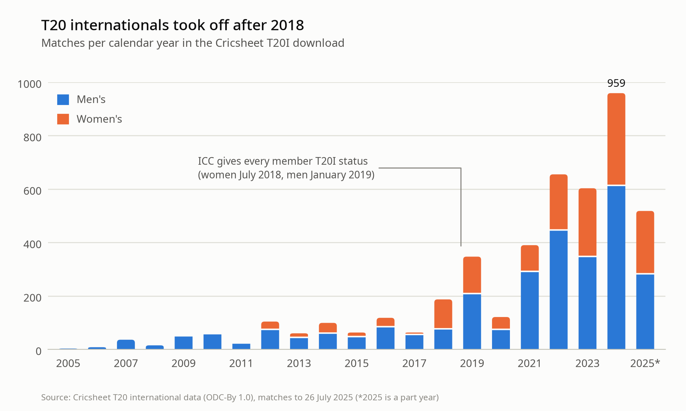
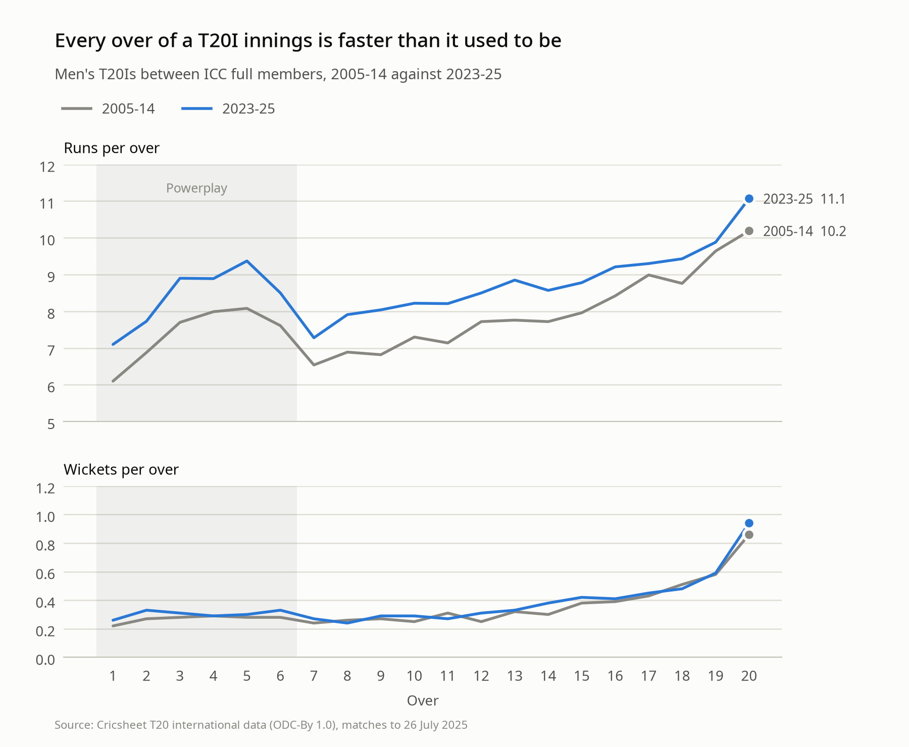
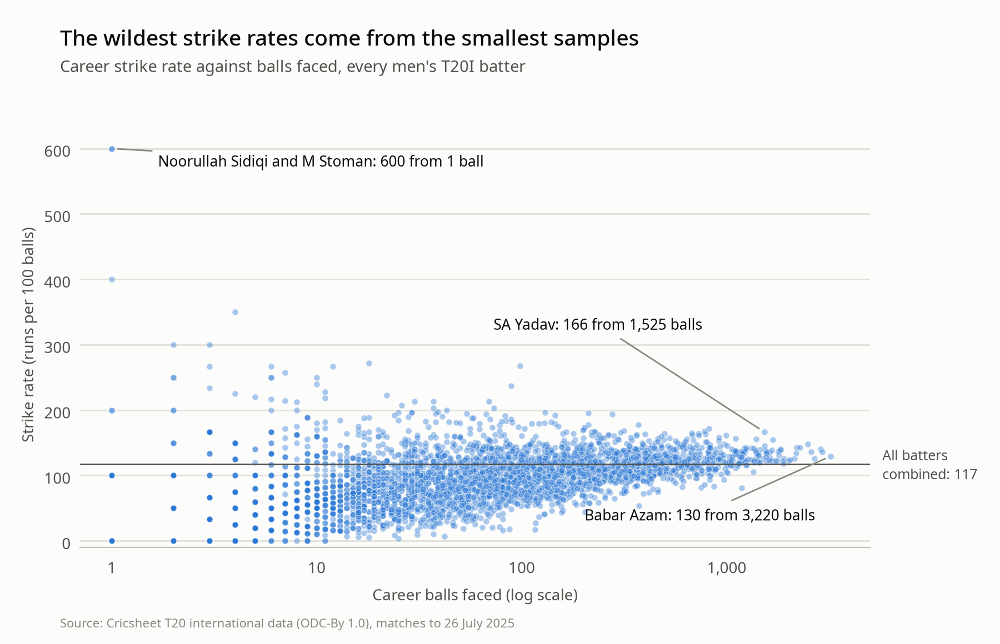

# Cricket Analytics

Exploring ball-by-ball T20 international data from [Cricsheet](https://cricsheet.org) with Python, pandas and Jupyter, written up as the *Discovering Cricket Data* blog series.

| | Session | What it covers |
| --- | --- | --- |
| #1 | [Unpacking one match](posts/introduction.md) · [notebook](model/CricketVis-Session1.ipynb) | The CSV2 format, data types, nulls and a scorecard for England's win in Karachi, September 2022 |
| #2 | [From one match to 4,484](posts/scaling-up.md) · [notebook](model/CricketVis-Session2.ipynb) | Loading every T20I, fixing the gotchas Session 1 missed, and asking bigger questions of the data |

## Findings

From 4,484 T20 internationals (2,860 men's and 1,624 women's, about a million deliveries) played up to 26 July 2025.

### T20 internationals took off after 2018

<picture>
  <source media="(prefers-color-scheme: dark)" srcset="figures/matches-per-year-dark.png">
  
</picture>

The ICC gave every member's T20 matches international status from July 2018 (women) and January 2019 (men). Matches went from 187 in 2018 to 959 in 2024. Most of that growth is Associate cricket: 96 of 2024's 611 men's T20Is were between two full members. Trends over time therefore use full-member matches only.

### Every over is faster than it used to be

<picture>
  <source media="(prefers-color-scheme: dark)" srcset="figures/innings-shape-dark.png">
  
</picture>

In men's T20Is between full members, 2023-25 against 2005-14:

| Phase | Runs per over | Wickets per over |
| --- | --- | --- |
| Powerplay (overs 1-6) | 7.39 → 8.42 | 0.27 → 0.30 |
| Middle (7-15) | 7.31 → 8.25 | 0.28 → 0.31 |
| Death (16-20) | 9.14 → 9.70 | 0.54 → 0.55 |

Batters score faster without getting out much more often. The average first-innings total has gone from 155 to 171, and 24% of first innings now reach 200, up from 8%. In women's matches between full members, the average first innings rose from 117 to 140.

### The toss is a coin flip

Toss winners won **50.0%** of 2,671 men's T20Is with a result (not counting D/L finishes), and 51.4% of 1,531 women's. Batting first won 49.0% of men's matches (50.8% of women's).

### Small samples produce the wildest numbers

<picture>
  <source media="(prefers-color-scheme: dark)" srcset="figures/strike-rate-funnel-dark.png">
  
</picture>

The highest strike rates in men's T20Is (600) belong to two batters who have faced one ball each. Strike rates converge on the overall rate of 117 as the evidence grows, which is the case for shrinking small-sample stats towards the average (empirical Bayes) rather than using minimum-balls cut-offs.

## Data gotchas

Session 1 tripped over several of these. The [data dictionary](data_dictionary/README.md) covers the full list.

- **Two files per match.** 8,968 CSVs means 4,484 matches: `<id>.csv` (ball-by-ball) and `<id>_info.csv` (match details).
- **Overs count legal deliveries only.** Wides and no-balls are re-bowled, and overs are written `overs.balls`, so 116 legal deliveries is 19.2 overs.
- **Read `ball` as text.** An over with 10+ deliveries produces `0.10`, which is `0.1` as a float. That affects 1,458 deliveries.
- **Innings 3+ are super overs.**
- **Run outs aren't the bowler's wickets.**
- **Names aren't unique.** 52 names belong to more than one player. Use the registry IDs in the info files.

## Repository layout

```text
posts/                 Blog write-ups (Hugo front matter; images point at /images/cricket-data/)
model/
  CricketVis-Session1.ipynb
  CricketVis-Session2.ipynb
  plotting.py          Chart styling; renders every chart in light and dark
figures/               Charts exported by Session 2
data_dictionary/       Column-by-column notes and data-quality findings
scripts/
  download_data.sh     Fetches the Cricsheet T20I CSVs into data/
etl/                   Go module for the planned ingestion pipeline
data/                  Raw and processed data (git-ignored)
```

## Running it

```bash
python -m venv .venv
source .venv/bin/activate        # fish: source .venv/bin/activate.fish
pip install -r requirements.txt
./scripts/download_data.sh

cd model && jupyter lab
```

Session 2 writes `data/processed/deliveries.parquet` and `matches.parquet` (later sessions can start from these) and regenerates everything in `figures/`. To re-run it headless:

```bash
jupyter nbconvert --to notebook --execute --inplace model/CricketVis-Session2.ipynb
```

Cricsheet keeps adding matches, so a fresh download will give slightly different numbers from the write-ups, which use the snapshot up to 26 July 2025.

## Roadmap

- Empirical Bayes talent index: shrink strike rates and economy rates towards the average, weighted by sample size
- Adjust player ratings for opposition strength
- Go ETL with validation schemas, and automated ingestion on AWS

## Data licence

Match data is from [Cricsheet](https://cricsheet.org) and is available under the [Open Data Commons Attribution License](https://opendatacommons.org/licenses/by/1-0/). This repository doesn't include the raw data. Run `scripts/download_data.sh` to fetch it.
